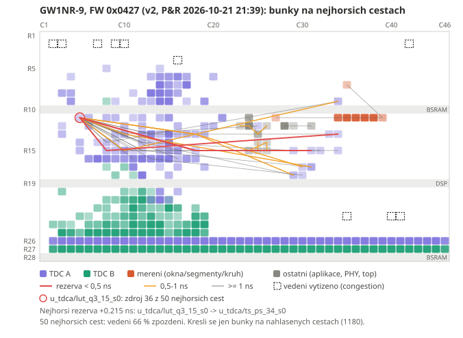

# Rozložení FPGA (GW1NR-9) – audit a optimalizace (2026-10-23)

Zdroje: **[P&R]** `impl/pnr/Counter_FPGA.tr` a `Counter_FPGA.rpt.txt` z buildu FW 0x0427 (v2) 2026-10-21 21:39 (Gowin
V1.9.12; tentýž build jako `2026-10-22_optimalizace-bitstreamu.md`) · **[SIM]** Icarus 13 na macOS · **[ÚVAHA]** odhad,
rozhodne P&R. Bitstream v3 (FW 0x0500) se zatím nesestavoval – Gowin běží jen na Windows. Navazuje na
`2026-10-22_optimalizace-bitstreamu.md` (O1–O7): tady se rozpracovávají O1, O2 a O3 a přidává se mapa.
🔴 Při ověřování změn se našla **chyba RTL v3 z FW 0x0500** (kap. 5, L-0198) – opravena.

## 1. Mapa

`data/2026-10-23_rozlozeni-fpga_0x0427.svg` generuje `Frequency_Counter_FPGA_Module/tools/floorplan_svg.py` z textového
timing reportu. Po každém P&R stačí spustit `python tools/floorplan_svg.py impl/pnr/Counter_FPGA.tr mapa.svg` (pro v3
`v3/impl/pnr/...`). ⚠️ Report nese polohu jen u buněk na **nahlášených cestách** (50 nejhorších + cesty z obou řetězů TDC:
1 180 buněk z ~4 000), ne úplné obsazení (`.db` je binární). Ukazuje ale přesně to, co rozhoduje o rezervě. Čárkovaný
rámeček = dlaždice s vytížením vedení 100 %, kroužek = zdroj s nejvíc nejhoršími cestami.

## 2. Nálezy [P&R]

| # | co | data | závěr |
|---|---|---|---|
| R1 | **jeden registr řídí 36 z 50 nejhorších cest** | `u_tdca/lut_q3[15]` v R11C5 (u BSRAM v řádku R10, vlevo), fan-out 34, rezerva **+0,215 ns** (nejhorší v návrhu); multiplexery R13–16 C8–18, nahlášené registry `ts_ps` R9–18 C25–34 | kap. 3 |
| R2 | dlouhý úsek je **LUT → FF**, ne FF → LUT | cesta 1: Q 2,79 → LUT `n1368` v **R15C8** (2,8 ns vedení) → D `ts_ps[34]` v **R13C34** (4,2 ns); vedení 82 % cesty, 66 % v 50 nejhorších | multiplexer leží u zdroje, registr u spotřebitele (odečet okna `u_wra`, R11 C27–39) – přes ~26 sloupců v jednom taktu |
| R3 | `rt_dly → rt_run` (7 cest), `boot_cnt → boot_done` CE (1) | +0,80 / +0,60 ns, 4 úrovně LUT (porovnání 20/24 b do RESET/CE) | O2, kap. 4.2 |
| R4 | `coh_hold` (5 cest) | +1,76 ns | bez zásahu |
| R5 | řetězy TDC | R26 (A) a R27 (B) celé C2..C46, `check_tdc_placement.py` PASS; dekodéry `qd` A R5–21 C3–21, B R17–25 C2–19, cesty `q_r → qd` rezerva ≥ 2,9 ns | v pořádku; rozmístění řetězů je vynucené, neměnit |
| R6 | **vytížení vedení 100 %** v 10 dlaždicích | R2C2, R2C3, R2C7, R2C9, R2C10, R2C42, R4C16, R23C35, R23C40, R23C41 | R23C35–41 leží nad pravým koncem řetězů, odkud vedou vzorky tapů ~150–268 zpět k dekodérům vlevo [ÚVAHA]; časování to dnes neomezuje (cesty `q_r` ≥ 2,9 ns) |
| R7 | nejvyšší fan-out mimo hodiny | `u_app/idx[0]` 406, `idx[1]` 248 (mux TX 128:1, 10 MHz, rezerva 75 ns), `u_tdca/ld`, `u_tdcb/ld` 269 (+3,5 / +2,8 ns), `chan_sel` 198 | časování nevadí; mux 128:1 ve v3 odpadá (O4 = skladač v3) |
| R8 | CLS 79 % při logice 48 % | rozbor v `2026-10-22_optimalizace-bitstreamu.md` kap. 3 | kolik z toho je rozprostření kvůli časování, ukáže až sweep (O3) |

## 3. Proč vázne `lut_q3[15] → ts_ps` a proč ne původní návrh O1

`tdc.v`: `ts_ps <= {lut_q3[15] ? tr2 : tr1, lut_q3[13:0]}` (DUAL = 0). Jeden bit tabulky (`amt`) vybírá 34bitové slovo.
Placer dal 34 multiplexerů k jejich zdroji (`lut_q3` u BSRAM), registry `ts_ps` ke spotřebitelům na druhé straně čipu.
Dlouhé vedení tak zůstalo mezi LUT a FF (L-0199). Z toho plyne:

- **Replikace `lut_q3[15]`** (`syn_preserve`, Gowin `replicate_resources`) zkrátí jen první úsek (fan-out), druhý ne.
  Proto je replikace jen jedna z voleb sweepu (O3), ne oprava.
- **Výběr o takt dřív z `lut_q2`** (O1 v `2026-10-22_…`): `lut_q2` je **výstupní registr BSRAM** (syntéza ho vtáhne do
  bloku, komentář `tdc.v` u `lut_q2`, tCO ~3,5 ns). Výběr z něj by dal cestu tCO BSRAM + fan-out 34, tedy přesun problému,
  ne řešení. ❌ Nepoužito.
- ✅ **Registr ZA multiplexerem (`TSPIPE`)**: `ts_hq <= výběr(lut_q3[15], tr1, tr2)` a `ts_lq <= lut_q3[13:0]` se plní ve
  stejném taktu jako dřív `ts_ps` (tytéž hodnoty `tr*`, žádná past posuvného registru), `ts_ps <= {ts_hq, ts_lq}` o takt
  později. `ts_hq` může ležet u multiplexeru (LUT → FF v jedné CLS) a vedení přes čip dostane vlastní takt bez logiky.
  Cena: +49 FF na kanál (+98 = 1,5 % FF), `ts_valid` o takt později (T+10 místo T+9).

## 4. Provedené změny (jen v3; v2 beze změny)

### 4.1 `tdc.v` parametr `TSPIPE` (výchozí 0), `top_v3.v` `TDC_TSPIPE = 1`

- **v3:** index hrany se zachytí v T+3 a čeká ve FIFO (hloubka 2, `seg_chan3`) na `ts_valid`. Při spouštění nejdřív po
  5 taktech nesmí přijít index třetí hrany dřív než značka první: T+L < T+10+3, takže latence do T+12 je bezpečná.
  `bub_o` (platné od dv2+1 do další události ≥ 5 taktů) a `code_o` se drží, s latencí se posouvat nemusí.
- **v2 zůstává 0:** `win_recip`/`regr_acc` páruje značku s indexem poslední spuštěné hrany v okamžiku `ts_valid`
  (PROTOKOL_V3 kap. 10.1). Pozdější `ts_valid` mění, ke které hraně značka patří, a posun se v regresi vyruší jen při
  stálém kroku spouštění. Bez testu na to by šlo o změnu měření v ověřeném bitstreamu, proto ne.
- Pro `TSPIPE = 0` je logika shodná s dřívější (`ts_hq/ts_lq/tv_w` bez zátěže syntéza odstraní). Simulací ověřeno, že
  záznamy v3 jsou s T+9 a T+10 **bitově shodné** (ladicí výpis téhož záznamu: N, X0, SX, ST stejné).

### 4.2 Registrovaný konec čítačů v `top_v3.v` (O2)

`boot_tc <= (boot_cnt == konec − 1)` a `rt_tc <= rt_run & (rt_dly == 2^20 − 2)`. Konec náběhu i odkladu opakování
kalibrace se pak bere z jednoho FF, takže do CE `boot_done`/`cal_boot` a do RESET `rt_run` už nevede porovnání 24/20 b.
`boot_done` i `rt_go` se nastaví **ve stejném taktu jako dřív**. `top.v` (v2) beze změny.

## 5. Chyba nalezená při ověřování (FW 0x0500, L-0198) – opraveno

S TSPIPE spadl `topv3` na `SX = N(N−1)/2` (60 chyb). Příčinou nebyla nová latence: `v3_ring` nastaví `clear` a shodí
`freeze` v **témže taktu**. Značka, která přijde právě v taktu `clear`, tak projde `take`, přičte `xm − x0`, `tm − t0` se
**starým** X0/T0 do právě vynulovaných součtů nového segmentu a N ji nezapočte. Výsledek: SX = N(N−1)/2 + N_předchozí − 1.

- **Proč to test neviděl:** A (10 MHz + 813 ppb) i B (17,3 MHz × 250 µs = 4325) měly na segment celý počet period.
  Fáze značek vůči hranici segmentu za běh skoro stála a při T+9 do taktu `clear` nepadla; při T+10 ano.
- **Na desce:** při libovolném kmitočtu postihne ~(značek za takt) segmentů, při 10 MHz ~10 %. Kmitočet se nezkreslí
  (chybný člen leží na přímce t = P·x, těžiště se posune podél ní), záznam je ale vnitřně nekonzistentní.
- **Oprava:** `take = pop & ~hold & ~freeze & ~clear` – značka v taktu `clear` se zahodí jako značky během `freeze`.
- **Test:** kanál B bez celého počtu period na segment, fáze se posouvá ~0,25 taktu za segment. Přibylo počítadlo
  pokrytí „značka v taktu `clear`“ (chk > 0) a mutace bez `~clear`.
- **Důkaz, že chyba byla už v 0x0500:** RTL z HEAD (T+9) s novým testem: 11 chyb SX, rozdíl přesně 4324 = N_předchozí − 1;
  HEAD + oprava: 0 chyb ve všech třech režimech.
- **Vedlejší nálezy testu:** (a) mez sklonu ST/SX (2 × 60 ps) nestačila, když B prošel všechny fáze TDC (segment zkrácený
  maskováním, N 164, chyba 1,50·10⁻⁵ při mezi 1,47·10⁻⁵, záznam jinak konzistentní a shodný pro T+9 i T+10) → 2 × 100 ps
  podle chyby jedné značky modelu; (b) s T+10 a B 17,3 MHz (rozestup hran 5/6 taktů) se mutace „FIFO hloubky 1“ stala
  ekvivalentní (stálý posun o hranu se v rozdílech vyruší) → B **16,100161 MHz** (rozestup 6/7, posun se rozejde; L-0199).

## 6. Ověření [SIM]

| co | výsledek |
|---|---|
| regrese v2 (`sim/run.ps1`: 29 testů v2 vč. `topselfchk`, `topregr`, `topchan`, `stmcal`, `tdc*`, `close2`) + `phyv3` | **30/30 PASS** (TSPIPE = 0 = beze změny) |
| v3 konečný stav: `topv3` (B 16,100161 MHz) | **PASS**, značka v taktu `clear` B 5×, T0 proti skutečné hraně max 181 ps A / 159 ps B |
| v3 konečný stav: `topv3ovf`, `topv3cal` | **PASS** (s opravou a TSPIPE; mez sklonu se potom jen uvolnila) |
| stav po opravě, před TSPIPE (HEAD + `~clear`, B 17,300173 MHz) | `topv3`, `topv3ovf`, `topv3cal` **PASS**, značka v taktu `clear` B 14× |
| mutace `sim/mut_top_v3.py` (15 = dosavadních 13 + „značka v taktu `clear` se přičte“ + „`ts_valid` o takt dřív“) | 15/15 zachyceno |
| ekvivalence `boot_tc`/`rt_tc` s původním porovnáním (obě verze vedle sebe, plné šířky 24/20 b, 60 M taktů; výpadek hodin 3 takty před koncem náběhu, náhodné dávky selhání kalibrace) | **0 rozdílů**: plný náběh 1×, zkrácený 5×, opakování kalibrace 35× |

Mutanty, které se netestují (ekvivalentní): horní část z `tr*` o takt později (konstantní posun všech značek o T, v
rozdílech se vyruší, A i B stejně) a dolní část z `lut_q3` o takt později (kód `code_r` se drží ≥ 5 taktů, takže jde o
tutéž položku tabulky). ⚠️ Opakování kalibrace po selhání (`rt_*`) žádný test v3 neprochází, proto kontrola ekvivalence.

## 7. Nástroje (O3) – ⬜ neověřené na Windows

| soubor | co dělá |
|---|---|
| `tools/floorplan_svg.py` | mapa z `.tr` (kap. 1) + souhrn: nejhorší cesta, podíl vedení, zdroje s nejvíc cestami, vytížení vedení, fan-out. Ověřeno na reportu 0x0427 (macOS). |
| `tools/pnr_sweep.tcl` | jedna syntéza, pak P&R pro `place_option 0–3 × route_option 0–2 × replicate_resources 0/1` (24 běhů, ~12 min). Ukládá `.tr` a `.rpt.txt` do `impl/sweep/<p_r_x>/` (v3: `v3/impl/sweep`), bitstream ne. Na konci vrátí volby z `build*.tcl` a smaže `.fs`. Projekt se volí `set SWEEP=v2` / `v3`. Neznámou volbu zapíše do `sweep.log` a přeskočí. |
| `tools/pnr_sweep_report.py` | tabulka běhů (stejné parsery jako `fpga_release.py`): setup/hold, Fmax, CLS, reg, `check_tdc_placement.py`. Použitelný běh = bez porušení, rezerva ≥ 0, CLS ≤ 85 %, TDC PASS. Přidá mapu nejlepšího běhu; `--md` vypíše tabulku sem. Parsování ověřeno na reportu 0x0427. |

⚠️ Rezerva jednoho běhu je zčásti náhoda rozmístění (FW 0x0421: stejná volba bez porušení ve 3 z 8 běhů). Volbu v
`build*.tcl` proto měnit až podle opakovaného sweepu (nový `BLD_TIME` = jiný vstup P&R) a vždy přes `tools/fpga_release.py`.

## 8. Na Windows (pořadí)

1. Z `Frequency_Counter_FPGA_Module`: `python tools/fpga_release.py --v3 --build` = `gw_sh v3/build_v3.tcl` + brána
   vydání jako u v2 (setup/hold, nejistota ≥ 0,9 ns, CLS ≤ 85 %, registry, piny `device.cfg`, rozmístění TDC, identita
   `build_id.vh`), navíc top `top_v3` a FW 0x05xx ze `src/app_v3.v`; SDC je `src/timing_v3.sdc`. Při PASS vydá
   `ab_test/FW_0x0500_v3_<čas>_<git>.fs` a řádek `ab_test/MANIFEST.md` se sloupcem FW `0x0500 (v3)`, při FAIL nic.
   Jen kontrola bez vydání: `--v3 --no-copy`; selftest (bez Gowinu): `python tools/fpga_release.py --selftest`.
   ⚠️ Řádek „Kontrola bitstreamu" ukáže skutečné jméno výstupu: `Counter_FPGA.*`, nebo `Counter_FPGA_v3.*`, pokud ho
   Gowin odvodí od projektu `Counter_FPGA_v3.gprj` [HYPOTÉZA, rozhodne první P&R]. Ve druhém případě opravit jména
   v `build_v3.tcl` (mazání starých výstupů, L-0132) a v `pnr_sweep.tcl`; brána přijme obě, obě naráz = FAIL.
   Pak `python tools/floorplan_svg.py v3/impl/pnr/Counter_FPGA.tr v3_mapa.svg` (jméno `.tr` podle brány) → první mapa v3.
   Očekávání [HYPOTÉZA]: cesta `lut_q3 → ts_ps` zmizí z prvních 50 (dva takty místo jednoho), CLS pod 79 %.
2. Kdyby nejhorší byla jiná cesta s vysokým fan-out: stejný postup (registr za LUT, ne před výstup BSRAM).
3. `set SWEEP=v3` + `gw_sh .../tools/pnr_sweep.tcl`, pak `python tools/pnr_sweep_report.py v3/impl/sweep --md` → tabulka sem.
4. v2 (`SWEEP=v2`) jen jako měřítko voleb. RTL v2 se kvůli rozložení nemění, dokud běží ověřený 0x0427.

## 9. Zvažované a nepoužité

| možnost | proč ne |
|---|---|
| omezení polohy (`INS_LOC`/oblast) pro `ts_ps` nebo jádro v3 | křehké: poloha spotřebitelů je ve v3 jiná než ve v2 a před prvním P&R v3 neznámá; řetězy TDC už vynucené jsou |
| posunout řetězy TDC / zkrátit je | ne: řádky R26/R27 hlídá `check_tdc_placement.py`, rezerva řetězu B za studena 3 tapy (#297) |
| `TSPIPE` i ve v2 | kap. 4.1 (párování indexu v `win_recip`), v2 je ověřený bitstream |
| shodit `freeze` v `v3_ring` až takt po `clear` (místo `~clear` v `seg_chan3`) | rovnocenné; `~clear` je lokální v bloku, který součty drží, a `clear` je tam už vstupem |
